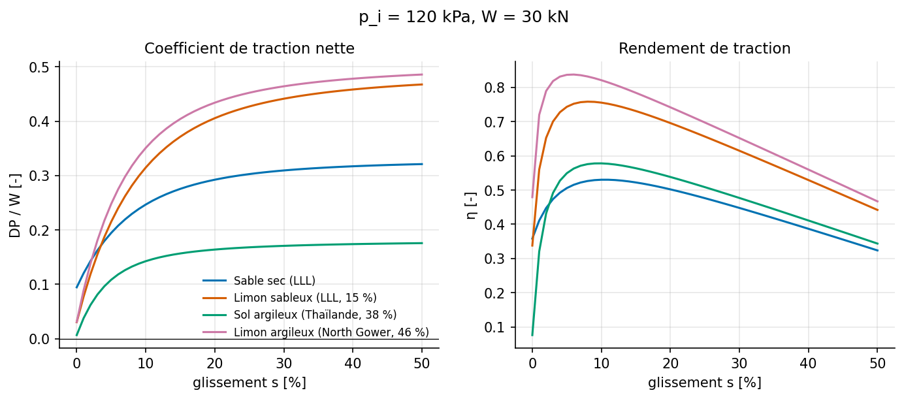
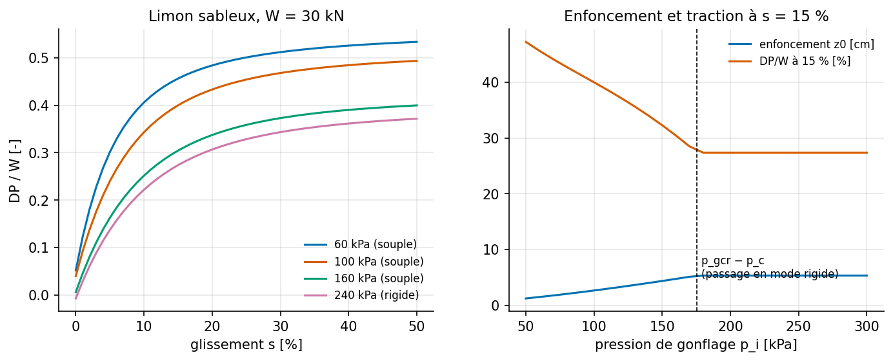
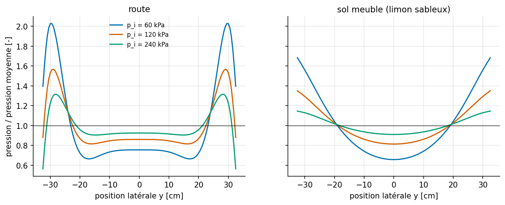
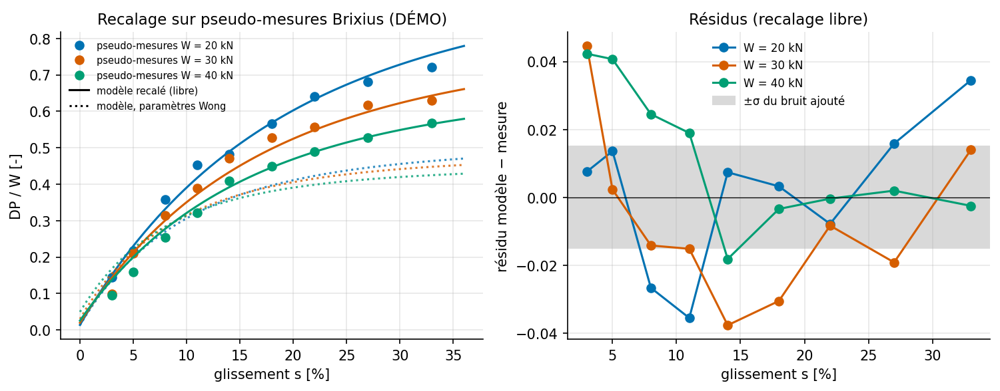

# AgriTireSim

**Simulation Python de la traction d'un pneu agricole sur sol meuble (terramécanique de Bekker–Wong)
et de son usure sur route (modèle de brosse + loi d'Archard). Le projet comprend aussi un modèle
éléments finis 2D de l'empreinte (scikit-fem), des plans d'expériences numériques et un recalage des
paramètres de sol.**

  

C'est un projet personnel d'élève ingénieur. L'objectif est de traduire la physique en équations, de
construire un protocole de simulation et de l'analyser avec un regard critique, en confrontant le
modèle à une référence indépendante.

> ⚠️ **Honnêteté sur les données** : je n'ai pu récupérer aucune courbe expérimentale publiée sous forme
> numérique. La partie « confrontation » utilise des **pseudo-mesures de démonstration** générées par la
> corrélation empirique de Brixius (1987), bruitées. Elles sont étiquetées comme telles partout.
> Voir [`data/experimental/README.md`](data/experimental/README.md).

---

## Résultats clés

| | |
|---|---|
|  |  |
| **Traction nette et rendement** pour 4 sols (paramètres de Wong, 2008). | **Effet de la pression de gonflage** : de 200 à 60 kPa, l'ornière est 1,7 à 5× moins profonde et DP/W augmente de 0,15 à 0,2. Le modèle reste continu au passage souple → rigide. |
|  |  |
| **FEM** : à basse pression, surpression aux épaules (jusqu'à 2× la moyenne sur route) ; le sol meuble lisse la distribution. | **Recalage** : R² = 0,98, mais avec une cohésion non physique. Le modèle compense une erreur de structure, et les résidus sont structurés. |

Quelques constats tirés de l'analyse (détails dans [`report.md`](report.md)) :

- **Glissement nul ≠ traction nulle** pour une roue sur sol meuble : la cinématique de l'arc d'entrée
  cisaille déjà le sol à s = 0. Le modèle et l'essai doivent donc utiliser la même définition du
  glissement.
- **Identifiabilité** : avec des essais à pression constante, la cohésion c et l'angle de frottement φ
  sont presque parfaitement corrélés (ρ = −0,99). Le plan d'essais conditionne ce qu'on peut identifier.
- **Usure** : elle croît en ~F_x³ avec l'effort transmis. La surpression aux épaules donnée par le FEM
  ne modifie le profil d'usure que de ±3 %. La pression seule n'explique donc pas l'usure irrégulière.
- La **pression de gonflage** domine toutes les sensibilités au sol. À pression fixée, la largeur seule a
  un effet faible ou défavorable.

## Contenu

```
agritire/
├── soil.py            paramètres de Bekker de 4 sols (Wong, 2008), conversions SI
├── terramechanics.py  pneu souple « arc + méplat », pression critique, Wong–Reece, empreinte plane
├── wear.py            empreinte sur route, modèle de brosse, Archard, profil latéral d'usure
├── fem_contact.py     FEM 2D scikit-fem (P2, déformation plane, Winkler unilatéral, ensemble actif)
├── doe.py             plan factoriel, hypercube latin, SRC / Spearman
├── calibration.py     référence de Brixius, moindres carrés bornés, covariance et identifiabilité
└── plotting.py        style graphique commun
notebooks/             01 traction · 02 usure · 03 FEM · 04 DOE + recalage (exécutés, avec figures)
tests/                 138 tests de cohérence physique et de vérification numérique
data/experimental/     pseudo-mesures de DÉMONSTRATION + procédure pour de vraies données
report.md              note de synthèse : hypothèses, équations, résultats, écarts, limites
scripts/               génération des données de démo et des notebooks
```

## Modèles en bref

| Module | Équations | Sources |
|---|---|---|
| Sol | σ = (k_c/b + k_φ) zⁿ ; τ = (c + σ tan φ)(1 − e^(−j/K)) | Bekker (1969) ; Janosi & Hanamoto (1961) |
| Traction | équilibre W = ∫(σ cosθ + τ sinθ) ; DP = H − R_c ; mode rigide/souple selon p_gcr | Wong & Reece (1967) ; Wong (2008) |
| Usure | brosse u = min(u + s dx, μp/c_p) ; dV/dX = k_A b ∫ p v_g/V dx | Pacejka (2012) ; Archard (1953) |
| FEM | ∫ σ:ε(v) + ∫ k_w u_z v_z = ∫ f·v ; P2, déformation plane | scikit-fem (Gustafsson & McBain, 2020) |
| DOE | factoriel 3³×3, hypercube latin, SRC + R² | McKay et al. (1979) ; Saltelli et al. (2008) |

## Vérification

Les 138 tests `pytest` couvrent notamment :

- l'équilibre vertical (écart < 10⁻⁶) ;
- l'identité R_c = b k z₀^(n+1)/(n+1) ;
- l'empreinte plane : s = 0 ⇒ H = 0 ;
- la borne de Mohr–Coulomb, la monotonie et la continuité au changement de mode ;
- la brosse contre la solution analytique de Pacejka, et le bilan d'énergie E_f = F_x·s ;
- un patch test FEM exact, l'équilibre des réactions et la convergence en maillage ;
- le recalage, qui retrouve des paramètres connus.

```text
$ python -m pytest -q
........................................................................ [ 52%]
..................................................................       [100%]
138 passed
```

## Installation et exécution (Windows / Git Bash)

```bash
py -3.10 -m venv .venv
```

```bash
source .venv/Scripts/activate
```

```bash
pip install -r requirements.txt && pip install -e .
```

```bash
python -m pytest -q
```

```bash
python scripts/build_notebooks.py --execute
```

Sous PowerShell, l'activation se fait avec `.venv\Scripts\Activate.ps1`. La dernière commande
régénère et exécute les 4 notebooks et les figures de `figures/` (environ 1 minute).

## Limites (résumé)

- Aucune validation sur de vraies mesures.
- Paramètres de sol issus de la littérature ; module K supposé.
- Pression uniforme sur le méplat ; pas d'hystérésis interne, donc un rendement surestimé.
- Pas de crampons.
- FEM 2D linéaire sur fondation de Winkler.
- Usure en indice relatif : k_A et C_s ne sont pas identifiés.

La liste complète des limites et des pistes d'amélioration est dans [`report.md` §7](report.md#7-limites-et-perspectives).

## Références principales

Bekker (1969), *Introduction to Terrain-Vehicle Systems* · Wong (2008), *Theory of Ground Vehicles*,
4th ed. · Wong & Reece (1967), *J. Terramechanics* 4(1) · Janosi & Hanamoto (1961), ISTVS ·
Archard (1953), *J. Appl. Phys.* 24 · Pacejka (2012), *Tire and Vehicle Dynamics* · Brixius (1987),
ASAE 87-1622. La liste complète est dans [`report.md`](report.md#8-références).

## Licence

MIT
