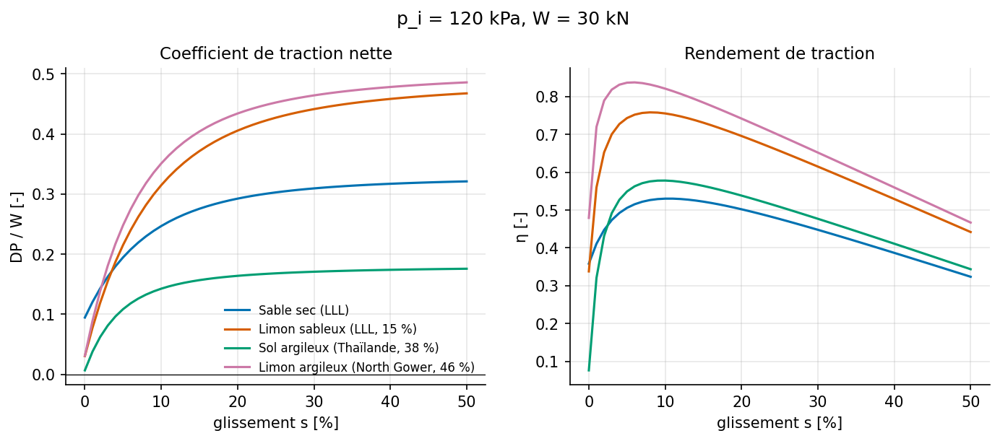
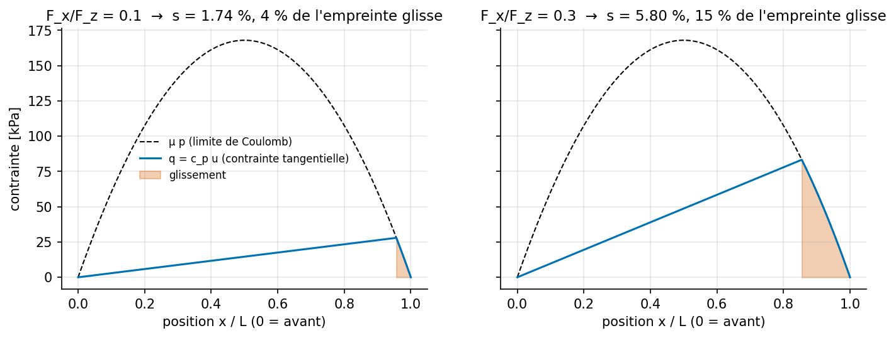
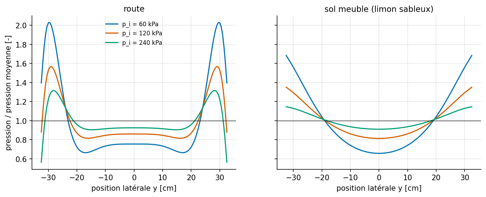
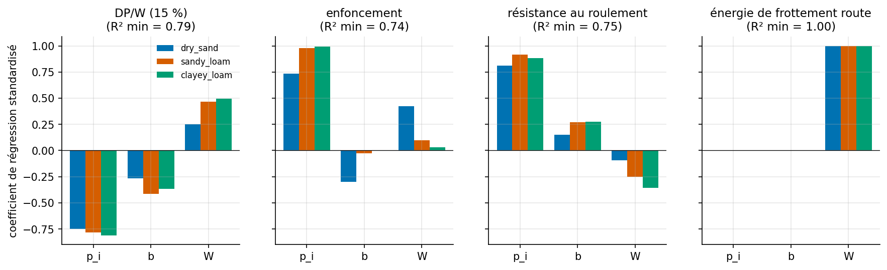
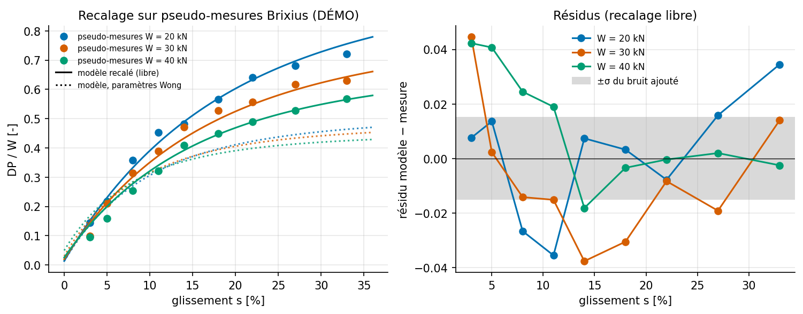

# Note de synthèse : traction sur sol meuble et usure sur route d'un pneu agricole

*AgriTireSim, version 0.1. Toutes les valeurs sont reproductibles avec `python scripts/build_notebooks.py --execute`.*

---

## 1. Objet et périmètre

Construire et analyser de façon critique une chaîne de simulation simple pour un pneu agricole radial
générique 650/65R38 :

1. **traction sur sol meuble** : effort au crochet en fonction du glissement, du sol et de la pression
   de gonflage (terramécanique de Bekker–Wong) ;
2. **usure sur route** : localisation du glissement dans l'empreinte et indice d'usure (brosse + Archard) ;
3. **pression de contact** sous la bande de roulement par éléments finis 2D (scikit-fem) ;
4. **plans d'expériences** numériques et analyse de sensibilité ;
5. **recalage** des paramètres de sol sur des courbes traction/glissement, puis analyse des écarts.

Le but n'est pas de remplacer un code industriel (Abaqus, modèles FE pneu–sol couplés). Il est de
montrer une démarche complète : hypothèses explicites, équations sourcées, vérification numérique,
confrontation à une référence indépendante et regard critique sur les limites.

> **Données.** Je n'ai pu récupérer aucune courbe traction/glissement expérimentale publiée sous forme
> numérique. La confrontation (§6) utilise des **pseudo-mesures de démonstration** générées par la
> corrélation empirique de Brixius (1987), bruitées. Elles sont étiquetées comme telles partout
> (`data/experimental/DEMO_brixius_pseudo_mesures.csv`, colonne `source`). **Ce ne sont pas des mesures.**

## 2. Données d'entrée et hypothèses

### 2.1 Pneu (générique, pas de données constructeur)

| Grandeur | Valeur | Origine |
|---|---|---|
| Diamètre D / largeur b / hauteur de flanc h | 1,81 m / 0,65 m / 0,42 m | désignation 650/65R38 |
| Contribution de carcasse p_c | 20 kPa | **hypothèse** (ordre de grandeur ; se mesure par écrasement sur sol rigide) |
| Charge de référence W | 30 kN | ordre de grandeur, roue arrière de tracteur |
| Gomme (FEM) | E = 6 MPa, ν = 0,45 | **hypothèse** |
| Ceinture équivalente isotrope (FEM) | E = 500 MPa, ν = 0,3, 12 mm | **hypothèse** |
| Rigidité de glissement C_s / F_z | 6 | **hypothèse** (à identifier sur banc) |
| Frottement gomme/route μ | 0,8 | hypothèse usuelle (sec) |

### 2.2 Sols (Wong, 2008, chap. 2 : tableau des paramètres de Bekker)

| Sol | n | k_c [kN/m^(n+1)] | k_φ [kN/m^(n+2)] | c [kPa] | φ [°] | K [m] |
|---|---|---|---|---|---|---|
| Sable sec (LLL) | 1,10 | 0,99 | 1528,43 | 1,04 | 28,0 | 0,025* |
| Limon sableux (LLL, 15 %) | 0,70 | 5,27 | 1515,04 | 1,72 | 29,0 | 0,020* |
| Sol argileux (Thaïlande, 38 %) | 0,50 | 13,19 | 692,15 | 4,14 | 13,0 | 0,010* |
| Limon argileux (North Gower, 46 %) | 0,73 | 41,6 | 2471 | 6,1 | 26,6 | 0,015* |

\* **K n'est pas dans ce tableau** : ce sont des hypothèses d'ordre de grandeur (1 à 2,5 cm pour les
sols meubles), recalées au §6. J'ai retranscrit les valeurs du tableau : il faut les revérifier sur
l'ouvrage avant tout usage hors pédagogie.

### 2.3 Hypothèses de modélisation

| # | Hypothèse | Conséquence attendue |
|---|---|---|
| H1 | Régime permanent, vitesse faible (pas d'effets dynamiques ni de vitesse dans le sol) | — |
| H2 | Sol homogène, semi-infini, paramètres de Bekker indépendants de la taille de la roue | les paramètres de plaque s'extrapolent mal aux grands pneus |
| H3 | Pas de bulldozing ni de rebond élastique du sol (angle de sortie nul) | sous-estime légèrement la résistance |
| H4 | Pneu souple : méplat à pression uniforme p_g = p_i + p_c | la pression réelle n'est pas uniforme (§5.3) |
| H5 | Pas d'hystérésis interne du pneu ni d'effet des crampons | surestime le rendement |
| H6 | Glissement défini par rapport au rayon libre R ; couple rapporté au même rayon | cohérence énergétique (η ≤ 1) ; écart de couple ≈ δ/R |
| H7 | Route indéformable, pression longitudinale parabolique, μ constant | usure en valeur relative seulement |
| H8 | FEM : élasticité linéaire, déformation plane, Winkler, contact sans frottement | ordres de grandeur et tendances, pas de valeurs absolues |

## 3. Modèles et équations

### 3.1 Traction sur sol meuble (`agritire/terramechanics.py`)

**Lois de comportement du sol**

- Pression–enfoncement (Bekker, 1969) : σ = (k_c/b + k_φ) zⁿ
- Cisaillement (Janosi & Hanamoto, 1961) : τ = (c + σ tan φ)(1 − e^(−j/K))

**Cinématique.** Glissement s = 1 − V/(ωR). Sur l'arc d'entrée, le déplacement de cisaillement
accumulé vaut j(θ) = R[(θ₁ − θ) − (1 − s)(sin θ₁ − sin θ)] (Wong & Reece, 1967). Sur le méplat, il croît
de s par unité de longueur.

**Deux modes de fonctionnement** (Bekker, 1969 ; Wong, 2008) :

- on résout d'abord la roue **rigide** équivalente (inconnue : enfoncement z₀, équation :
  équilibre vertical). Sa pression au point bas définit la **pression critique** p_gcr ;
- si p_g = p_i + p_c ≥ p_gcr, le pneu est **rigide** ;
- sinon il est **souple** : z₀ = (p_g/k)^(1/n) est imposé par la pression au sol, et l'écrasement δ est
  l'inconnue. Le contact se compose d'un arc avant (θ_f → θ₁) et d'un méplat de longueur 2R sin θ_f.

**Équations d'équilibre et efforts** (b = largeur) :

```
W  = R b ∫arc (σ cosθ + τ sinθ) dθ + b ∫méplat σ dξ        (résolue pour z₀ ou δ, solveur de Brent)
H  = R b ∫arc τ cosθ dθ + b ∫méplat τ dξ                    poussée brute
Rc = R b ∫arc σ sinθ dθ = b k z₀^(n+1)/(n+1)               résistance de compaction (identité exacte)
DP = H − Rc                                                  effort au crochet
T  = R² b ∫arc τ dθ + R b ∫méplat τ dξ                        couple
η  = DP·R(1 − s) / T                                         rendement de traction
```

Les deux modes **coïncident à la transition** (δ = 0). Le modèle est donc continu en pression. Un
premier prototype juxtaposait « empreinte plane » et « roue rigide de Wong–Reece » : il était
discontinu à la transition, et la traction y augmentait avec la pression. Je l'ai abandonné pour cette
raison.

Deux formulations sont conservées pour comparaison : l'empreinte plane analytique de Bekker,
H = (Ac + W tan φ)[1 − K/(sL)(1 − e^(−sL/K))], et la roue rigide de Wong–Reece (maximum de σ décalé
vers l'avant, θ_m = (c₁ + c₂s)θ₁, avec c₁ = 0,4 et c₂ = 0,25).

### 3.2 Usure sur route (`agritire/wear.py`)

- Empreinte : L = F_z/(b p_g), p(x) parabolique, ∫ p b dx = F_z.
- Modèle de brosse (Pacejka, 2012) : raideur de poil c_p = 2C_s/(bL²). On marche de l'avant vers
  l'arrière : u_i = min(u_{i−1} + s dx, μp_i/c_p). La récurrence se réécrit comme un minimum cumulé,
  ce qui la rend vectorisable.
- Vitesse de glissement : v_g/V = s − du/dx dans la zone glissante.
- Archard (1953) appliqué localement : dV/dX = k_A b ∫ p (v_g/V) dx. Énergie de frottement :
  E_f = b ∫ μp (v_g/V) dx [J/m].
- k_A n'est pas connu : les résultats sont donnés en **indice relatif**.

### 3.3 Éléments finis (`agritire/fem_contact.py`)

Coupe transversale y–z au centre de l'empreinte, en déformation plane. Bicouche (ceinture + gomme),
triangles P2, environ 6 000 ddl. Formulation faible :

```
∫Ω σ(u):ε(v) dΩ + ∫Γc k_w u_z v_z dΓ = −∫Γsommet p_i v_z dΓ − ∫Γépaule q_s v_z dΓ
```

- Conditions aux limites : symétrie u_y = 0 sur l'axe ; face latérale libre ; ressorts de Winkler
  verticaux sous la gomme, en **contact unilatéral** (ensemble actif).
- Chargement : effort de flanc p_c b/2 réparti sur une bande d'épaule de 5 cm.
- Sol : k_w = p/z(p), module sécant de la loi de Bekker au point de fonctionnement. Route : k_w = 10¹¹ N/m³.

### 3.4 Plans d'expériences (`agritire/doe.py`)

- Facteurs : p_i ∈ [60, 200] kPa, b ∈ [0,45, 0,85] m (rapport d'aspect 65 %), W ∈ [20, 45] kN, sol (3 niveaux).
- Plans : factoriel complet 3³ × 3 (81 calculs) et hypercube latin de 100 points par sol (McKay et al., 1979).
- Sensibilité : coefficients de régression standardisés (SRC) accompagnés du R² du méta-modèle
  linéaire, et corrélations de rang de Spearman (Saltelli et al., 2008).
- Contrainte de faisabilité : écrasement estimé sur route ≤ 25 % de la hauteur de flanc (hypothèse).

### 3.5 Recalage (`agritire/calibration.py`)

- Moindres carrés non linéaires bornés (`scipy.optimize.least_squares`, méthode TRF) sur (c, φ, K).
- Covariance linéarisée Cov ≈ σ²(JᵀJ)⁻¹, d'où les écarts-types et la matrice de corrélation.
- Les paramètres d'enfoncement (n, k_c, k_φ) **ne sont pas recalés** : ils se mesurent par essai de
  plaque (bevameter). Les essais préliminaires ont montré qu'ils sont fortement corrélés à c et K
  (|ρ| > 0,9) quand on les recale sur des courbes de traction.

## 4. Vérification numérique

La **vérification** (« résout-on correctement les équations ? ») est séparée de la **validation**
(« sont-ce les bonnes équations ? », §6). 138 tests `pytest` couvrent :

| Contrôle | Résultat |
|---|---|
| Équilibre vertical W_intégré = W, 4 sols × 3 pressions × 3 glissements | écart < 10⁻⁶ |
| R_c intégré = formule de Bekker b k z₀^(n+1)/(n+1) | écart < 0,2 % |
| Enfoncement roue rigide : intégration vs formule approchée de Bekker | écart de −3,3 % à +5,7 % (attendu : approximation parabolique) |
| Empreinte plane : intégration vs solution analytique | écart < 10⁻⁴ |
| Empreinte plane : s = 0 ⇒ H = 0 et DP = −R_c | exact |
| Borne de Mohr–Coulomb H ≤ c b L + W tan φ | respectée |
| Monotonie DP(s) ; pression ↓ ⇒ enfoncement ↓ et DP ↑ ; continuité à p_gcr | respectées |
| Brosse numérique vs solution analytique de Pacejka | écart < 10⁻⁵ |
| Bilan d'énergie E_f = F_x·s | écart < 0,2 % (grille fine) |
| FEM, couche homogène sur Winkler : pression et déplacement analytiques (patch test) | exact à 10⁻⁸ |
| FEM : Σ réactions = effort appliqué | 10⁻¹³ |
| FEM : convergence en maillage du pic de pression | écart de 0,75 % entre n_y = 65 et n_y = 260 |
| Recalage : on retrouve des paramètres connus sans bruit | écart < 0,1 % |

## 5. Résultats

### 5.1 Traction sur sol meuble



| Sol | p_i [kPa] | Mode | z₀ [cm] | DP/W à 15 % | R_c/W | η_max (à s) |
|---|---|---|---|---|---|---|
| Sable sec | 60 / 120 / 200 | souple / souple / rigide | 6,8 / 11,4 / 11,8 | 0,42 / 0,28 / 0,26 | 0,06 / 0,16 / 0,18 | 0,80 (4,5 %) / 0,53 (10,5 %) / 0,50 (12 %) |
| Limon sableux | 60 / 120 / 200 | souple / souple / rigide | 1,5 / 3,3 / 5,3 | 0,46 / 0,37 / 0,27 | 0,02 / 0,06 / 0,13 | 0,91 (3,5 %) / 0,76 (8 %) / 0,57 (14 %) |
| Sol argileux | 60 / 120 / 200 | souple / souple / rigide | 1,3 / 3,9 / 6,0 | 0,25 / 0,16 / 0,08 | 0,02 / 0,08 / 0,15 | 0,89 (3 %) / 0,58 (9,5 %) / 0,28 (17 %) |
| Limon argileux | 60 / 120 / 200 | souple | 0,9 / 1,9 / 3,5 | 0,49 / 0,40 / 0,31 | 0,01 / 0,03 / 0,10 | 0,94 (2 %) / 0,84 (5,5 %) / 0,65 (11 %) |

- Baisser la pression de 200 à 60 kPa divise l'enfoncement par 2 à 5 et augmente DP/W de 0,15 à 0,2.
  C'est le mécanisme qui justifie les pneus « basse pression » (VF/IF) et le télégonflage.
- Le rendement maximal est atteint entre 2 et 17 % de glissement. Les valeurs de η > 0,85 sont
  **surestimées**, faute d'hystérésis interne du pneu (H5) : les ordres de grandeur mesurés sont
  plutôt de 0,7 à 0,8.
- **Glissement nul ≠ traction nulle** dans le modèle complet. À s = 0 (rayon libre), la cinématique de
  l'arc donne j = O(θ₁³) > 0, donc une petite poussée. Le roulement libre se situe à s légèrement
  négatif. Pour comparer à des essais, il faut une définition commune du glissement de référence
  (ASABE S296).
- Le choix de formulation (arc + méplat, empreinte plane, Wong–Reece) fait varier DP/W d'environ 0,1 :
  c'est une incertitude de modèle du même ordre que celle des paramètres de sol.

### 5.2 Usure sur route



- La zone glissante naît à l'arrière de l'empreinte. Elle couvre 4 % de la longueur pour F_x/F_z = 0,1
  (s = 1,7 %) et 15 % pour F_x/F_z = 0,3 (s = 5,8 %).
- L'indice d'usure croît en loi puissance d'exposant ≈ 3 avec l'effort transmis aux faibles efforts.
  Limiter le patinage sur route est donc le premier levier.
- Dans ce modèle, l'effet de la pression de gonflage est **nul par construction** : avec C_s/F_z fixé
  et une pression parabolique, la solution ne dépend que de F_x/(μF_z). C'est une limite, pas un
  résultat. Il faut une rigidité de glissement C_s(p_i, W) mesurée.

### 5.3 Pression de contact (FEM)



| Support | p_i [kPa] | p_moy [kPa] | p_max / p_moy |
|---|---|---|---|
| Route | 60 / 120 / 240 | 80 / 140 / 260 | 2,03 / 1,57 / 1,32 |
| Sol (limon sableux) | 60 / 120 / 240 | 80 / 140 / 260 | 1,68 / 1,35 / 1,15 |

- La pression moyenne vaut exactement p_i + p_c par équilibre, ce qui est cohérent avec l'hypothèse H4.
- À basse pression, la part portée par les flancs crée une **surpression aux épaules**, jusqu'à 2× la
  moyenne sur route. Un support souple lisse la distribution.
- **Couplage FEM → usure** : alors que la pression varie d'un facteur ≈ 3 dans la largeur, l'usure ne
  varie que de ±3 % si le glissement est uniforme. Une bande plus chargée a une limite d'adhérence
  plus haute et glisse sur une zone plus courte. La pression seule n'explique donc pas l'usure
  irrégulière épaules/centre : il faut modéliser les variations de glissement dans la largeur (rayon
  de roulement local, dérive, crampons).

### 5.4 Sensibilités (hypercube latin, 3 × 100 calculs)



| Réponse | p_i | b | W | R² (min sur les sols) |
|---|---|---|---|---|
| DP/W à 15 % | −0,75 à −0,81 | −0,27 à −0,42 | +0,25 à +0,49 | 0,79 |
| Enfoncement | +0,74 à +0,99 | −0,30 à 0,00 | +0,03 à +0,42 | 0,74 |
| Résistance au roulement R_c/W | +0,81 à +0,92 | +0,15 à +0,27 | −0,09 à −0,36 | 0,75 |
| Énergie de frottement sur route | 0 | 0 | +1,00 | 1,00 |

- La **pression de gonflage** est le facteur dominant pour toutes les réponses au sol.
- À pression fixée, la **largeur** a un effet faible ou défavorable : l'ornière a la même profondeur mais
  elle est plus large. L'intérêt d'un pneu large passe par la pression plus basse qu'il autorise. Les
  facteurs b et p_i sont donc couplés en pratique, alors que le plan les traite comme indépendants.
- R² ≈ 0,75 à 0,8 sur le sable sec : le comportement y est non linéaire (changement de mode
  souple/rigide). Une analyse de Sobol serait plus appropriée.
- 6 configurations sur 81 du plan factoriel (60 kPa, 0,45 m, charges élevées) sortent du domaine réaliste.

## 6. Confrontation modèle / référence et écarts



**Vérification de la procédure.** Je génère des données avec le modèle lui-même (c = 8 kPa, φ = 27°,
K = 0,03 m, bruit σ = 0,015). Le recalage donne c = 11,1 ± 2,4 kPa, φ = 25,4 ± 0,9° et
K = 0,029 ± 0,001 m : on retrouve les vraies valeurs à moins de 2σ.

**Identifiabilité.** À pression constante, la corrélation c–φ vaut −0,994 (l'aire de contact est
proportionnelle à W). Avec une pression ajustée à la charge, elle tombe à −0,82. Le **plan d'essais
conditionne ce qui est identifiable**.

**Confrontation aux pseudo-mesures Brixius (DÉMO).**

| | Wong (tableau) | Recalage libre | Recalage c ≤ 25 kPa |
|---|---|---|---|
| c [kPa] | 1,72 | 59,7 ± 5,7 | 25 (borne) |
| φ [°] | 29,0 | 25,1 ± 1,9 | 34,6 |
| K [m] | 0,020 | 0,039 ± 0,003 | 0,035 |
| RMSE sur DP/W | — | 0,023 | 0,039 |
| R² | — | 0,984 | 0,954 |

**Analyse des écarts**

1. Le très bon R² du recalage libre repose sur une **cohésion non physique** (≈ 35× la valeur du
   tableau pour ce sol). Le modèle compense une **erreur de structure** par un paramètre : un bon R²
   ne valide pas les paramètres.
2. Les résidus sont **structurés**. Le modèle surestime DP/W aux faibles glissements, surtout aux fortes
   charges : c'est l'effet de l'arc d'entrée et de la définition du glissement de référence. Il
   reproduit aussi mal la baisse de DP/W avec la charge que contient Brixius, qui intègre des effets
   de pneu (hystérésis, déformation de carcasse) absents ici.
3. Avec c contraint à une plage plausible, le RMSE passe à 0,039, soit ≈ 2,6× le bruit : c'est une
   estimation de l'**erreur de modèle** sur ce cas.
4. La référence elle-même est empirique (pneus diagonaux, indice de cône). La confrontation teste la
   cohérence entre deux modèles, **pas** la validité physique contre la mesure.

## 7. Limites et perspectives

| Limite | Effet | Piste |
|---|---|---|
| Pas de vraies mesures | aucune validation | numériser des courbes publiées (source citée) ; réserver un jeu de validation |
| Paramètres de sol de la littérature, K supposé | incertitude de premier ordre | bevameter + boîte de cisaillement sur le sol d'essai |
| Pression de contact uniforme sur le méplat (H4) | effet de la charge mal représenté | distribution issue d'un FEM pneu 3D, ou modèle à pression variable |
| Pas d'hystérésis ni de crampons (H5) | rendement surestimé | terme de résistance interne mesuré au banc |
| Pas de multi-passage ni de dynamique | pas de compaction cumulée | modèle de répétition de charge (Wong) |
| Usure : C_s et k_A inconnus, crampons absents | indice relatif seulement, insensible à la pression | identification sur banc ; modèle de pavé |
| FEM linéaire 2D, Winkler | tendances seulement | hyperélasticité (Mooney-Rivlin), 3D, sol continu élasto-plastique (Drucker-Prager), contact frottant : périmètre Abaqus |
| SRC sur réponses non linéaires | sensibilités approximatives | indices de Sobol (SALib) |

## 8. Références

- Archard, J.F. (1953). Contact and rubbing of flat surfaces. *Journal of Applied Physics*, 24(8), 981–988.
- ASABE Standard S296 : *General terminology for traction of agricultural traction and transport devices and vehicles*.
- ASABE Standard D497 : *Agricultural Machinery Management Data*.
- Bekker, M.G. (1969). *Introduction to Terrain-Vehicle Systems*. University of Michigan Press.
- Brixius, W.W. (1987). *Traction prediction equations for bias ply tires*. ASAE Paper No. 87-1622.
- Gustafsson, T., McBain, G.D. (2020). scikit-fem: A Python package for finite element assembly. *Journal of Open Source Software*, 5(52), 2369.
- Janosi, Z., Hanamoto, B. (1961). The analytical determination of drawbar pull as a function of slip for tracked vehicles in deformable soils. *Proc. 1st Int. Conf. ISTVS*, Turin.
- Johnson, K.L. (1985). *Contact Mechanics*. Cambridge University Press.
- McKay, M.D., Beckman, R.J., Conover, W.J. (1979). A comparison of three methods for selecting values of input variables in the analysis of output from a computer code. *Technometrics*, 21(2).
- Pacejka, H.B. (2012). *Tire and Vehicle Dynamics*, 3rd ed. Butterworth-Heinemann.
- Saltelli, A. et al. (2008). *Global Sensitivity Analysis. The Primer*. Wiley.
- Schallamach, A., Turner, D.M. (1960). The wear of slipping wheels. *Wear*, 3(1), 1–25.
- Wong, J.Y., Reece, A.R. (1967). Prediction of rigid wheel performance based on the analysis of soil-wheel stresses, Part I. *Journal of Terramechanics*, 4(1).
- Wong, J.Y. (2008). *Theory of Ground Vehicles*, 4th ed. Wiley.
- Zienkiewicz, O.C., Taylor, R.L. (2000). *The Finite Element Method*, vol. 1, 5th ed. Butterworth-Heinemann.
